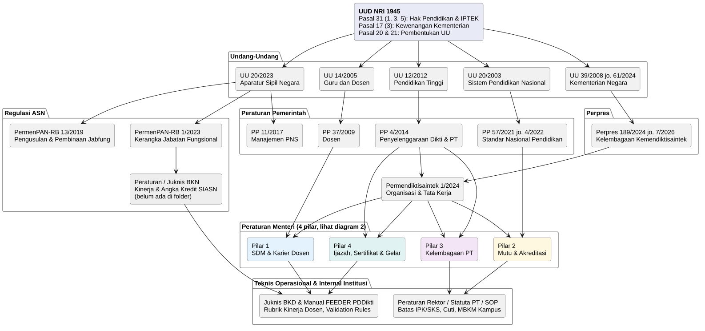
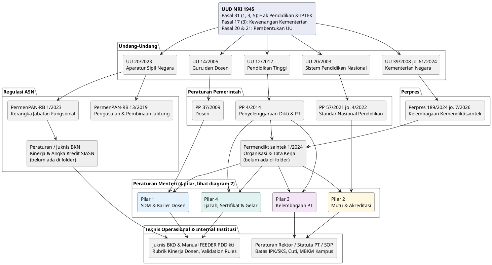
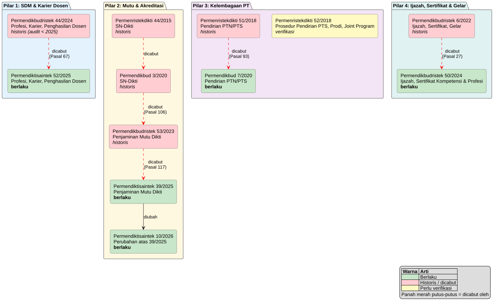
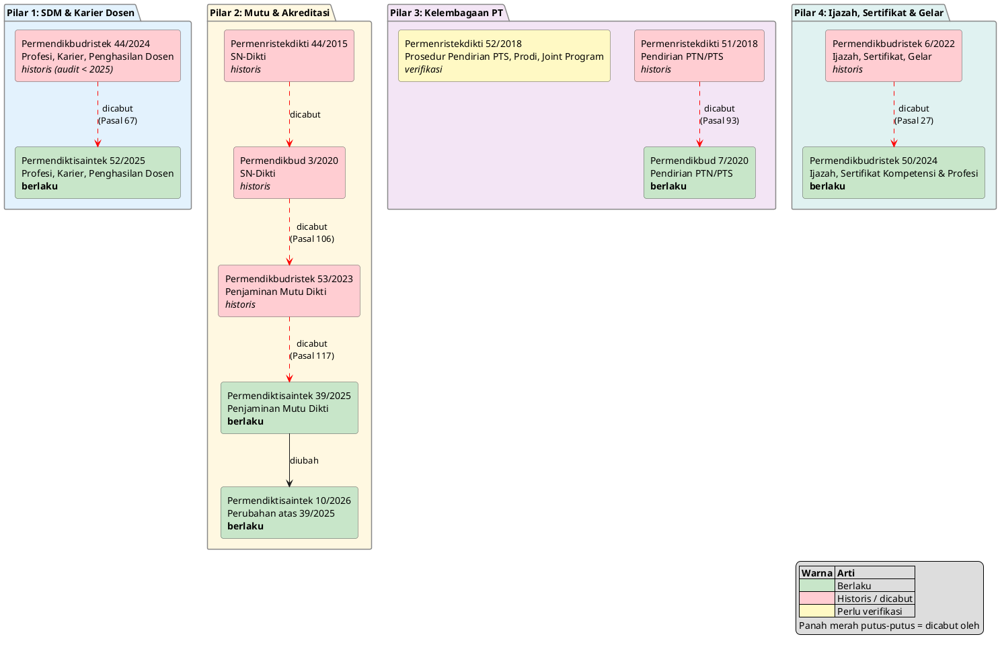
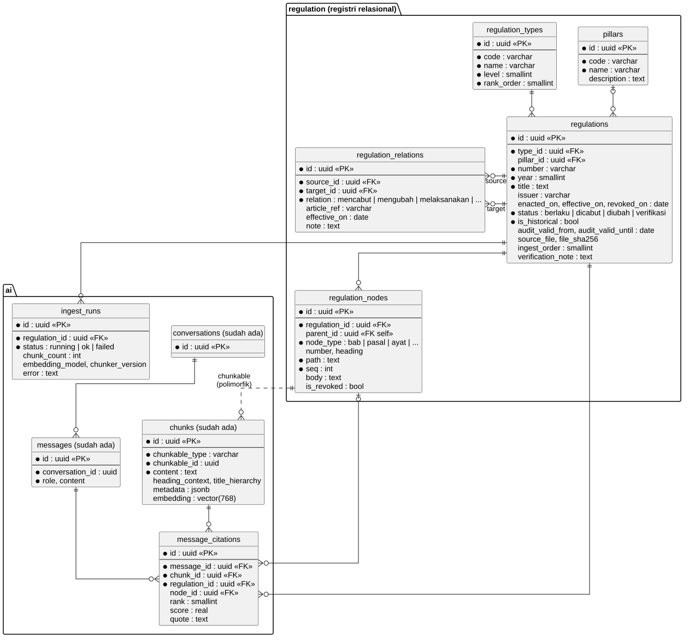
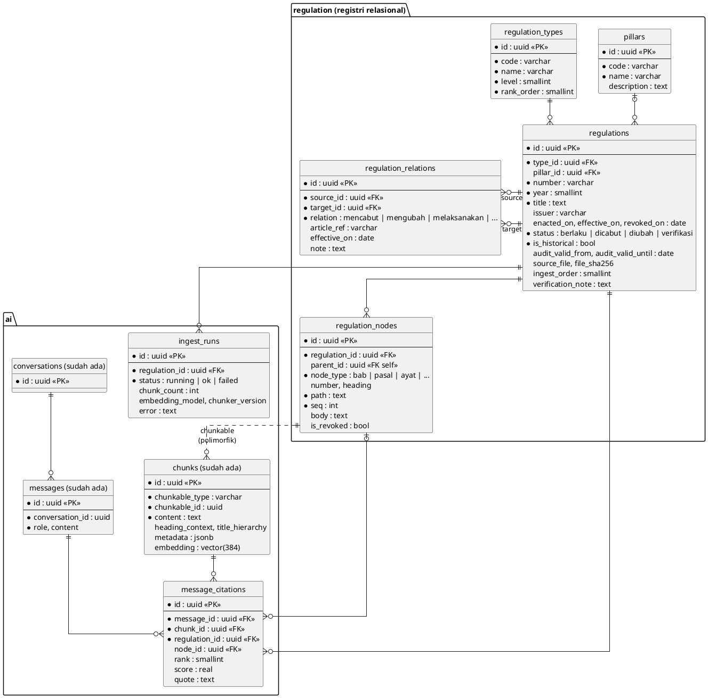

# Knowledge Base Regulasi Pendidikan Tinggi

Hierarki peraturan, status berlaku/dicabut, dan urutan unggah (ingest) dokumen di `legislation_regulation/`.

Status diverifikasi dari pasal penutup tiap dokumen (pasal "dicabut dan dinyatakan tidak berlaku"). Yang belum bisa diverifikasi dari isi folder ditandai **(verifikasi)**.

## 1. Hierarki

Sumber diagram ada di `diagram/*.puml` (render SVG di folder yang sama). Render ulang: `plantuml -tsvg diagram/*.puml`.

### 1.1 Hierarki peraturan (UUD sampai teknis operasional)



<details><summary>Kode PlantUML</summary>



</details>

### 1.2 Peraturan Menteri per pilar dan rantai pencabutan



<details><summary>Kode PlantUML</summary>



</details>

## 2. Peraturan Menteri per Pilar

Rantai pencabutan terbaca dari atas (historis) ke bawah (berlaku).

### Pilar 1: SDM & Karier Dosen

| Peraturan | Tentang | Status |
|---|---|---|
| Permendikbudristek No. 44/2024 | Profesi, Karier, dan Penghasilan Dosen | Historis. Dicabut Permendiktisaintek 52/2025 (Pasal 67). Dipakai untuk audit < 2025. |
| Permendiktisaintek No. 52/2025 | Profesi, Karier, dan Penghasilan Dosen | **Berlaku** |

### Pilar 2: Mutu & Akreditasi Dikti

| Peraturan | Tentang | Status |
|---|---|---|
| Permenristekdikti No. 44/2015 | SN-Dikti | Historis. Dicabut Permendikbud 3/2020 (bersama No. 50/2018). |
| Permendikbud No. 3/2020 | SN-Dikti | Historis. Dicabut Permendikbudristek 53/2023 (Pasal 106). |
| Permendikbudristek No. 53/2023 | Penjaminan Mutu Pendidikan Tinggi | Historis. Dicabut Permendiktisaintek 39/2025 (Pasal 117). |
| Permendiktisaintek No. 39/2025 | Penjaminan Mutu Pendidikan Tinggi | **Berlaku** |
| Permendiktisaintek No. 10/2026 | Perubahan atas No. 39/2025 | **Berlaku** |

### Pilar 3: Kelembagaan Perguruan Tinggi

| Peraturan | Tentang | Status |
|---|---|---|
| Permenristekdikti No. 51/2018 | Pendirian, Perubahan, Pembubaran PTN; Pendirian, Perubahan, Pencabutan Izin PTS | Historis. Dicabut Permendikbud 7/2020 (Pasal 93). |
| Permenristekdikti No. 52/2018 | Prosedur Pendirian PTS, Pembukaan Prodi, Joint Program PTS | **(verifikasi)** Tidak termasuk daftar pencabutan Permendikbud 7/2020. |
| Permendikbud No. 7/2020 | Pendirian, Perubahan, Pembubaran PTN; Pendirian, Perubahan, Pencabutan Izin PTS | Berlaku menurut dokumen yang ada di folder. **(verifikasi)** adanya perubahan/penggantinya. |

### Pilar 4: Ijazah, Sertifikat & Gelar

| Peraturan | Tentang | Status |
|---|---|---|
| Permendikbudristek No. 6/2022 | Ijazah, Sertifikat Kompetensi, Sertifikat Profesi, Gelar, Kesetaraan Ijazah PT Negara Lain | Historis. Dicabut Permendikbudristek 50/2024 (Pasal 27). |
| Permendikbudristek No. 50/2024 | Ijazah, Sertifikat Kompetensi, dan Sertifikat Profesi Jenjang Pendidikan Tinggi | **Berlaku** menurut folder. **(verifikasi)** perubahan/penggantinya. |

Catatan: Permendikbudristek 50/2024 **bukan** tentang akreditasi, berbeda dengan versi diagram sebelumnya. Akreditasi diatur dalam Permendikbudristek 53/2023 dan Permendiktisaintek 39/2025 (menggantikan Permendikbud 5/2020 yang tidak ada di folder).

## 3. Urutan Unggah (Ingest)

Prinsip: induk dahulu, turunan kemudian; dalam satu pilar urutkan historis ke berlaku. Hierarki di RAG ditentukan oleh metadata (nomor, tahun, status), bukan urutan masuk.

| # | Level | File |
|---|---|---|
| 1 | L0 UUD | `UUD45_SatuNaskah.pdf` |
| 2 | L1 UU | `UU Nomor 20 Tahun 2003.pdf` |
| 3 | L1 UU | `UU Nomor 14 Tahun 2005.pdf` |
| 4 | L1 UU | `UU Nomor 39 Tahun 2008.pdf` |
| 5 | L1 UU | `UU Nomor 61 Tahun 2024.pdf` |
| 6 | L1 UU | `UU Nomor 12 Tahun 2012.pdf` |
| 7 | L1 UU | `UU Nomor 20 Tahun 2023.pdf` |
| 8 | L2 PP | `PP_No_37_2009.pdf` |
| 9 | L2 PP | `PP Nomor 04 Tahun 2014.pdf` |
| 10 | L2 PP | `PP Nomor 57 Tahun 2021.pdf` |
| 11 | L2 PP | `PP Nomor 4 Tahun 2022.pdf` |
| 12 | L3 Perpres | `Perpres Nomor 189 Tahun 2024.pdf` |
| 13 | L3 Perpres | `Perpres Nomor 7 Tahun 2026.pdf` |
| 14 | L3 ASN | `Permenpan Nomor 13 Tahun 2019.pdf` |
| 15 | L3 ASN | `Permen PANRB Nomor 1 Tahun 2023.pdf` |
| 16 | L4 Pilar 3 | `Permenristekdikti Nomor 51 Tahun 2018.pdf` |
| 17 | L4 Pilar 3 | `Permenristekdikti Nomor 52 Tahun 2018.pdf` |
| 18 | L4 Pilar 3 | `Permendikbud 7 tahun 2020.pdf` |
| 19 | L4 Pilar 2 | `Permenristekdikti Nomor 44 Tahun 2015.pdf` |
| 20 | L4 Pilar 2 | `3 Tahun 2020.pdf` (Permendikbud 3/2020) |
| 21 | L4 Pilar 2 | `Permendikbudridtek-No-53-Tahun-2023.pdf` |
| 22 | L4 Pilar 2 | `permendiktisaintek-no-39-tahun-2025.pdf` |
| 23 | L4 Pilar 2 | `permendiktisaintek-no-10-tahun-2026.pdf` |
| 24 | L4 Pilar 1 | `Permendikbudristek_No_44_Tahun_2024.pdf` |
| 25 | L4 Pilar 1 | `permendiktisaintek-no-52-tahun-2025.pdf` |
| 26 | L4 Pilar 4 | `Salinan Permen 6 Tahun 2022 upload.pdf` |
| 27 | L4 Pilar 4 | `Permendikbudristek_No_50_Tahun_2024.pdf` |
| 28 | L5 Teknis | `User-Guide-WS-2-Feeder-PDDIKTI-07-12-2020.pdf` |
| 29 | L5 Teknis | `guides/UG-UI-UX-FEEDER-PDDIKTI-VERSI-4.0-07-12-2020.pdf` |

## 4. Catatan

- Belum ada di folder: Permendiktisaintek No. 1/2024 dan Juknis BKN/BKD.
- Perpres 7/2026 adalah perubahan atas Perpres 189/2024.
- Permenpan 13/2019 mengatur pengusulan, penetapan, dan pembinaan jabatan fungsional PNS.
- Permenristekdikti 51 dan 52/2018 mengatur kelembagaan/pendirian PT, bukan SN-Dikti atau SPMI.
- Isi metadata `status` (berlaku/dicabut) dan `dicabut_oleh` di tiap chunk sesuai tabel bagian 2.

## 5. Rancangan ER-Diagram Basis Pengetahuan RAG

Sumber diagram: `diagram/er_knowledge_base.puml`. Migrasi ada di `server/migration/src/regulation/` dan `server/migration/src/ai/` (prefiks `m20261022_`).



<details><summary>Kode PlantUML</summary>



</details>

### 5.1 Prinsip

1. Hierarki, status, dan pencabutan disimpan sebagai data relasional (`regulation.*`), bukan hanya `metadata` di chunk. Perubahan status cukup di satu baris `regulations`.
2. `ai.chunks` tidak diubah. Chunk menunjuk ke `regulation_nodes` lewat `chunkable_type`/`chunkable_id` (polimorfik). `metadata` menyimpan salinan ringan (`level`, `status`, `pilar`) untuk pre-filter.
3. Struktur pasal (BAB, Bagian, Pasal, Ayat) disimpan sebagai pohon `regulation_nodes` agar sitasi tepat ("Pasal 67 ayat 2"). Unit chunk setingkat pasal; ayat panjang dipecah lagi.
4. Relasi antar-regulasi (mencabut, mengubah, melaksanakan, dst.) ada di `regulation_relations`. Bisa disinkronkan ke graf AGE `ai_graph` bila perlu traversal.

### 5.2 Tabel

| Skema | Tabel | Fungsi |
|---|---|---|
| `regulation` | `regulation_types` | Jenis dan level (L0 sampai L5) |
| `regulation` | `pillars` | Pilar 1 sampai 4 dan ASN |
| `regulation` | `regulations` | Registri dokumen: nomor, tahun, status, masa berlaku audit, file sumber |
| `regulation` | `regulation_relations` | Edge antar-regulasi beserta rujukan pasal |
| `regulation` | `regulation_nodes` | Pohon struktur pasal |
| `ai` | `chunks` (sudah ada) | Teks, embedding `vector(384)`, metadata |
| `ai` | `message_citations` | Sitasi jawaban ke chunk, regulasi, dan pasal |
| `ai` | `ingest_runs` | Riwayat ingest: model embedding, versi chunker, galat |

### 5.3 Pemetaan dari dokumen ini

- Level L0 sampai L5 (bagian 3) ke `regulation_types.level`; Pilar 1 sampai 4 ke `pillars`.
- Tabel rantai pencabutan (bagian 2) ke `regulation_relations`, misalnya Permendikbudristek 44/2024 `mencabut`-ke Permendiktisaintek 52/2025 (Pasal 67).
- Penanda **(verifikasi)** ke `status = 'verifikasi'` dan `verification_note`.
- Dokumen yang belum ada di folder (bagian 4) tetap dibuat sebagai baris `regulations` tanpa `source_file`, supaya relasinya tidak putus.
- Urutan unggah (bagian 3) ke `regulations.ingest_order`.

### 5.4 Isi `ai.chunks.metadata`

```json
{
  "regulation_id": "...", "type": "PERMEN", "level": 4,
  "number": "52", "year": 2025, "pillar": "SDM",
  "status": "berlaku", "is_historical": false,
  "dicabut_oleh": null, "pasal": "67", "ayat": "2"
}
```

### 5.5 Alur retrieval

1. Filter kandidat `status = 'berlaku'`, atau pakai `audit_valid_from`/`audit_valid_until` untuk audit periode lampau (mis. Permendikbudristek 44/2024 untuk audit < 2025).
2. Cari top-k dengan pgvector (cosine, indeks HNSW).
3. Naik hierarki lewat `regulation_relations` (`melaksanakan`) untuk menarik pasal induk (UU/PP) sebagai konteks.
4. Cek `mencabut`/`mengubah` untuk menyisipkan peringatan, mis. "diubah oleh Permendiktisaintek 10/2026".
5. Simpan hasil ke `message_citations`.

### 5.6 Catatan

- `ai.chunks.chunkable_id` tidak punya FK; integritas ke `regulation_nodes` dijaga di kode ingest.
- Dimensi vektor saat ini 384. Mengganti model embedding berarti embed ulang semua chunk; `ingest_runs.embedding_model` mencatat model yang dipakai.
- Migrator CLI rusak di dev DB (nama migrasi lama), jadi migrasi diterapkan satu per satu.
